<a href="https://adammostofi.pages.dev">
  <picture>
    <source media="(prefers-color-scheme: light)" srcset="assets/hero-light.svg">
    
  </picture>
</a>

  
  
  
  

  I came up through <b>IT and networks</b>, moved into <b>full-stack</b>, and now build <b>AI systems that can show their work</b>. 
  I like software that is small, tested, and honest about what it does.

 

<picture>
  <source media="(prefers-color-scheme: light)" srcset="assets/ch01-light.svg">
  
</picture>

<a href="https://github.com/AdamMostofi/ADAM">
  <picture>
    <source media="(prefers-color-scheme: light)" srcset="assets/card-adam-light.svg">
    
  </picture>
</a>

<a href="https://github.com/AdamMostofi/compliance-rag"><picture><source media="(prefers-color-scheme: light)" srcset="assets/card-rag-light.svg"></picture></a> <a href="https://github.com/AdamMostofi/multi-agent-web-build"><picture><source media="(prefers-color-scheme: light)" srcset="assets/card-agents-light.svg"></picture></a>

  

<picture>
  <source media="(prefers-color-scheme: light)" srcset="assets/ch02-light.svg">
  
</picture>

<a href="https://safar-travel-and-tourism.vercel.app"><picture><source media="(prefers-color-scheme: light)" srcset="assets/site-safar-light.svg"></picture></a> <a href="https://cconcept.pages.dev"><picture><source media="(prefers-color-scheme: light)" srcset="assets/site-cconcept-light.svg"></picture></a> <a href="https://kaakirealestate.pages.dev"><picture><source media="(prefers-color-scheme: light)" srcset="assets/site-kaaki-light.svg"></picture></a> <a href="https://crisp-xi.vercel.app"><picture><source media="(prefers-color-scheme: light)" srcset="assets/site-crisp-light.svg"></picture></a>

Need a site like these? I take freelance builds through <a href="https://amwebstudio.adammostofi.workers.dev">A.M Web Studio</a>.

 

<picture>
  <source media="(prefers-color-scheme: light)" srcset="assets/ch03-light.svg">
  
</picture>

<a href="https://github.com/AdamMostofi/codesentinel"><picture><source media="(prefers-color-scheme: light)" srcset="assets/card-sentinel-light.svg"></picture></a> <a href="https://github.com/AdamMostofi/chisel"><picture><source media="(prefers-color-scheme: light)" srcset="assets/card-chisel-light.svg"></picture></a> <a href="https://github.com/AdamMostofi/field-tools"><picture><source media="(prefers-color-scheme: light)" srcset="assets/card-field-light.svg"></picture></a> <a href="https://adammostofi.pages.dev"><picture><source media="(prefers-color-scheme: light)" srcset="assets/card-audit-light.svg"></picture></a>

  

<picture>
  <source media="(prefers-color-scheme: light)" srcset="assets/ch04-light.svg">
  
</picture>

<picture>
  <source media="(prefers-color-scheme: light)" srcset="assets/toolbox-light.svg">
  
</picture>

  

<picture>
  <source media="(prefers-color-scheme: light)" srcset="assets/ch05-light.svg">
  
</picture>


<b>The archive</b> — everything else, smaller and older

 

| Project | What it is | Stack |
|---|---|---|
| [art-gallery-fakih](https://github.com/AdamMostofi/art-gallery-fakih) | Bilingual (EN/AR) furniture brand site with a CMS admin | React · Vite · Payload |
| [amwebstudio](https://github.com/AdamMostofi/amwebstudio) | My studio site: websites for Beirut businesses | Astro · Cloudflare Workers |
| [Ani-WF](https://github.com/AdamMostofi/Ani-WF) | Animated-site toolkit and agent workflow | GSAP · TypeScript |
| [habit-tracker](https://github.com/AdamMostofi/habit-tracker) | Habits, streaks and stats | FastAPI · React 19 · SQLite |
| [nlp-emotion-classification](https://github.com/AdamMostofi/nlp-emotion-classification) | Fine-tuned DistilBERT (92.3%) vs zero-shot LLMs | Transformers · Hugging Face |
| [diabetes-risk-classification](https://github.com/AdamMostofi/diabetes-risk-classification) | Logistic regression vs random forest vs SVM | scikit-learn |
| [THE-SEVEN-GAINTS](https://github.com/AdamMostofi/THE-SEVEN-GAINTS) | Expedition portal (course project) | React · Express · MySQL |
| [exercises](https://github.com/AdamMostofi/exercises) | Daily Python and SQL practice ladder | Python · SQL |

 

<a href="https://adammostofi.pages.dev">
  <picture>
    <source media="(prefers-color-scheme: light)" srcset="assets/footer-light.svg">
    
  </picture>
</a>

Light or dark, this page follows your GitHub theme, like the <a href="https://adammostofi.pages.dev">portfolio</a> it comes from. The terminal above is the portfolio's amber mode.

